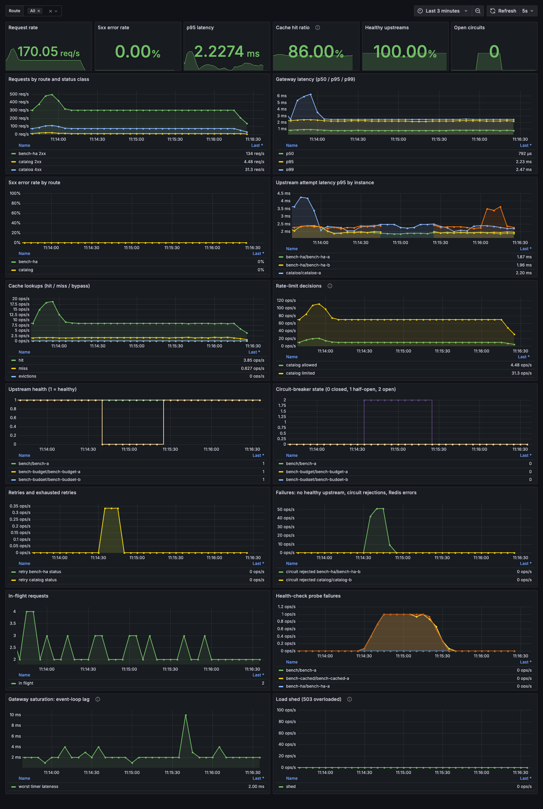

# Relay: an asynchronous Python API gateway, measured to destruction

[](../../actions/workflows/ci.yml)

Relay is a configuration-driven HTTP API gateway built on asyncio:
health-aware load balancing, Redis-backed distributed rate limiting, a
from-scratch LRU response cache with request coalescing, circuit breakers,
deadline-bounded safe retries with a retry budget, admission control, and
Prometheus/Grafana observability.

The point of the project is less the feature list than **the evidence**.
Every claim is backed by a test or a saved benchmark, and the benchmarks
found two serious bugs that 230+ passing tests had missed (see
[What the benchmarks found](#what-the-benchmarks-found)).

> **Portfolio project, not production-certified infrastructure.** See
> [SECURITY.md](docs/SECURITY.md) for the scope and known limitations.

## Highlights (all measured; sources linked)

| | Result | Evidence |
|---|---|---|
| Overload | Admission control keeps **~0.8–1.0k req/s of goodput** at up to 3.5× capacity; with it disabled the same code collapses to **~60 req/s** (metastable failure) | [open-loop sweep](docs/BENCHMARK_REPORT.md#3-overload-open-loop-arrival-rate-sweep-audit-a5-a17) |
| Bug found by benchmarking | An httpcore pool race leaked connections and turned an overload spike into a **permanent outage**; made structurally impossible, with a regression test | [AUDIT A16](docs/AUDIT.md), [ARCHITECTURE](docs/ARCHITECTURE.md#upstream-connection-pool-a-design-constraint-audit-a16) |
| Cache stampede | Request coalescing: **~80× fewer** upstream requests for a hot key, p99 halved | [report §5](docs/BENCHMARK_REPORT.md#5-cache-stampede-request-coalescing-audit-a3) |
| Distributed rate limiting | 3 separate gateway **processes**, 300 concurrent requests, capacity 40 → **exactly 40** admitted; Lua bucket agrees with a reference model on random timelines | `test_lifecycle.py`, `test_properties.py` |
| Gateway overhead | Against a 0 ms backend: about 5% of direct throughput (NGINX: 93%). Against a 50–100 ms backend: **83–88% of direct** | [report §1–2](docs/BENCHMARK_REPORT.md) |
| Horizontal scaling | **2.15×** with 2 instances, **4.14×** with 4 (paired) | [report §4](docs/BENCHMARK_REPORT.md#4-horizontal-scaling) |
| Test strength | 330+ tests (unit, integration, property-based, chaos, multi-process, adversarial); mutation testing: **every behavior-changing mutant killed** in the core modules | [QUALITY.md](docs/QUALITY.md), [TEST_PLAN.md](docs/TEST_PLAN.md) |

The honest part: against a backend that does nothing, Relay's uncached path
reaches only about 5% of direct throughput. That's the cost of a Python ASGI
hop on one core, and NGINX barely pays it. Relay's value is its policies,
not raw proxy speed, and the reports say so.

## Features

| Feature | How |
|---|---|
| Routing | Longest-prefix match on path-segment boundaries; upstreams only from validated YAML (no SSRF); dot segments rejected however encoded |
| Load balancing | Round-robin over healthy instances (default) or **least-request**, which routes around slow or hung instances |
| Health checks | One lifespan-managed task per route; consecutive-threshold hysteresis; dedicated client |
| Rate limiting | Token bucket in an **atomic Redis Lua script** on Redis server time; 429 + `Retry-After`; explicit fail-closed outage policy |
| Caching | From-scratch O(1) LRU (hash map + doubly linked list); conservative HTTP cache policy; local or shared Redis backend; **single-flight coalescing** |
| Circuit breakers | Per upstream; bounded half-open probes; generation-stamped permits so late results can't corrupt state; can't get stuck |
| Timeouts and retries | Connect / attempt / request deadlines; only GET/HEAD/OPTIONS retried; full-jitter backoff; **retry budget** caps aggregate amplification |
| Admission control | `max_in_flight` + bounded FIFO wait queue + cheap 503 `overloaded`; sized by Little's law; health endpoints never shed |
| Hardening | Header size/count limits (431), body limits (413), hop-by-hop stripping, no internals in errors, no secrets in logs or metric labels |
| Observability | Prometheus metrics with bounded labels (incl. event-loop lag, pool health, load shedding), JSON access logs, provisioned Grafana dashboard |

## What the benchmarks found

An [audit](docs/AUDIT.md) of v0.1 listed 15 gaps. Building the benchmark
suite to close them uncovered more, each now fixed and regression-tested:

1. **Permanent outage after an overload spike (critical).** Every route
   returned 504 forever, while the backend answered in 1 ms. The cause is a
   race in httpcore's connection pool (still present in the latest release):
   a waiter that gets a newly created connection and then times out or is
   cancelled orphans that connection forever. My first fix (stop cancelling
   httpx) only *reduced* it, which repeated runs exposed. The real fix makes
   the race unreachable: requests never wait in the pool queue, enforced by
   config validation.
2. **Metastable overload.** Requests queued inside the gateway until they
   timed out; the breaker blamed the healthy backend and stayed open. Fixed
   with admission control, iterated twice on data (shed cheaply in the
   outermost layer; add a bounded queue because clients that retry instantly
   collapsed goodput to ~117 req/s).
3. **Head-of-line coupling.** A hung backend held the gateway's concurrency
   slots, so requests for the *healthy* backend were shed. Least-request
   balancing routes around it.
4. **A cache-correctness hole that 96% coverage missed.** Mutation testing
   showed that `Cache-Control: max-age=60,no-store` (no space) would have
   been cached.
5. **Benchmarks that lied.** Host sleep froze the Docker VM mid-run (106 s
   "requests"); a "45% speedup" turned out, under A/B, to be the
   environment. The harness now discards stretched runs and the report uses
   paired comparisons.

Each of these is written up for interviews in
[INTERVIEW_GUIDE.md](docs/INTERVIEW_GUIDE.md).

## Monitoring

`docker compose up -d` provisions Prometheus and a Grafana dashboard. Below:
live traffic (300 req/s two-backend route plus a cached, rate-limited route)
while backend-b fails for 50 s. Its health drops, its breaker opens, a few
requests are retried, and the **client 5xx rate stays at 0%**.



## Architecture

```text
 client ──▶ Admission control (in-flight limit, FIFO queue, cheap 503) ──▶ header limits ──▶ request id/log/metrics
              │
              ▼
   route (longest prefix) ─▶ rate limit (Redis Lua) ─▶ read body (≤1 MiB) ─▶ cache lookup ─┬─ hit ──▶ response
                                                                                             └─ miss ─▶ single-flight
              ┌──────────────────────────────────────────────────────────────────────────────────────────┘
              ▼
   pick upstream (round-robin | least-request; healthy; breaker allows) ─▶ send (httpx per-phase timeouts,
   cooperative attempt budget) ─▶ safe retry? (GET/HEAD/OPTIONS, deadline, retry budget) ─▶ cache fill ─▶ response
```

Details: [ARCHITECTURE.md](docs/ARCHITECTURE.md) · API, errors, config:
[API_AND_CONFIG.md](docs/API_AND_CONFIG.md) · Decisions:
[ADR-001](docs/ADR-001-technology-choices.md)

## Quick start (Docker)

Prerequisites: Docker Desktop (or Docker Engine with Compose v2).

```bash
git clone https://github.com/OWNER/relay-api-gateway.git && cd relay-api-gateway
docker compose up -d --build
scripts/smoke_test.sh            # waits for readiness, then runs end-to-end checks
```

| URL | What |
|---|---|
| <http://localhost:8080> | Relay |
| <http://localhost:3000> | Grafana, dashboard "Relay API Gateway" (anonymous read-only) |
| <http://localhost:9090> | Prometheus |
| <http://localhost:8001>, <http://localhost:8002> | Mock backends (direct baseline and failure injection) |

All ports bind to `127.0.0.1`. Stop with
`docker compose --profile multi --profile bench --profile scale down`.

### Try it

```bash
for i in 1 2 3 4; do curl -s localhost:8080/api/bench-ha/items | jq -r .instance; done   # round-robin
curl -si 'localhost:8080/api/catalog/items?id=1' | grep -i x-relay-cache                  # MISS, then HIT
for i in $(seq 1 8); do curl -s -o /dev/null -w '%{http_code} ' localhost:8080/api/orders/x; done; echo  # 429s
curl -s -XPOST localhost:8002/__mock/config -d '{"fail_status":503,"healthy":false}'      # break backend-b
curl -s localhost:8080/__relay/routes | jq '.routes[] | select(.id=="bench-ha")'          # breaker/health
curl -s -XPOST localhost:8002/__mock/reset
```

A full walkthrough: [DEMO_SCRIPT.md](docs/DEMO_SCRIPT.md).

## Verify it yourself

```bash
scripts/verify.sh     # lint, mypy --strict, pip-audit, full tests vs a real Redis, Docker stack + smoke
```

It writes a timestamped log to `verification/`, so the evidence is your own
terminal output. Benchmarks: `scripts/bench_matrix.py` (about 2 h),
`scripts/chaos_timeline.py` (about 30 min), `scripts/ab_compare.py`. Run them
with the laptop **on AC power** (`caffeinate -s` only prevents sleep on AC).

## Local development

```bash
scripts/dev.sh setup        # .venv + pinned dependencies
scripts/dev.sh test         # full suite (Redis tests use fakeredis unless REDIS_URL is set)
scripts/dev.sh redis        # throwaway Redis on 127.0.0.1:6390, then:
REDIS_URL=redis://127.0.0.1:6390/15 .venv/bin/pytest --cov
.venv/bin/mypy              # strict type check
.venv/bin/relay --config config/routes.yaml --check   # validate a config file
```

## Tech stack

Python 3.12+ · FastAPI/Starlette · Uvicorn (uvloop, httptools) · HTTPX ·
redis-py (asyncio) + Lua · Pydantic v2 · prometheus-client · pytest,
Hypothesis, fakeredis, mutmut · Ruff, mypy, pip-audit · Docker Compose ·
Prometheus · Grafana · k6 · NGINX (benchmark baseline) · GitHub Actions

## Limitations

* Single process, single core per instance; scale by adding instances (each
  keeps its own LRU, breakers, and health state; rate limits stay global).
* Responses are buffered (10 MiB cap), not streamed. No WebSockets or HTTP/2
  upstreams.
* The cache implements a documented, conservative subset of HTTP caching.
* No TLS termination or client authentication; local demo only.
* Static admission limit (no adaptive AIMD/gradient limit yet).

## Project docs

[Architecture](docs/ARCHITECTURE.md) · [API & config](docs/API_AND_CONFIG.md) ·
[Benchmark report](docs/BENCHMARK_REPORT.md) · [Audit](docs/AUDIT.md) ·
[Quality evidence](docs/QUALITY.md) · [Test plan](docs/TEST_PLAN.md) ·
[Security](docs/SECURITY.md) · [Interview guide](docs/INTERVIEW_GUIDE.md) ·
[Demo script](docs/DEMO_SCRIPT.md) · [ADR-001](docs/ADR-001-technology-choices.md) ·
[Implementation status](docs/IMPLEMENTATION_STATUS.md) · [Original spec](PROJECT_SPEC.md)

## License

MIT. See [LICENSE](LICENSE).
