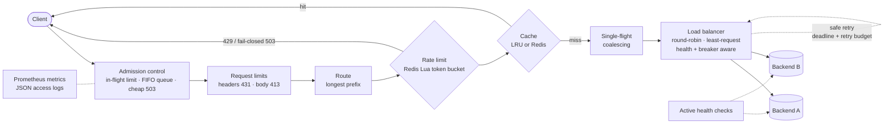

<div align="center">

# Relay

### An asynchronous Python API gateway, load-tested until it broke

Routing · health-aware load balancing · distributed rate limiting · LRU cache with request coalescing ·
circuit breakers · retry budgets · admission control · Prometheus/Grafana observability

[](https://github.com/thrisha432/relay-api-gateway/actions/workflows/ci.yml)


[](https://github.com/astral-sh/ruff)
[](LICENSE)

[Results](#results) · [What the benchmarks found](#what-the-benchmarks-found) · [Architecture](#architecture) · [Quick start](#quick-start) · [Docs](#documentation)

</div>

---

Relay sits between clients and backend services. It decides where each request
goes, protects backends from overload and retry storms, and reports what it is
doing. It is built on asyncio (FastAPI/Starlette, Uvicorn, HTTPX) with Redis for
state that has to be shared across instances.

The feature list is not the interesting part. **The evidence is.** Every claim
below is backed by a test or a saved benchmark run: 198 k6 runs with an NGINX
baseline, open-loop overload sweeps, chaos timelines, and A/B comparisons. That
benchmarking found serious bugs that 230+ passing tests had missed. The worst was
a race in httpcore's connection pool that turned a short overload spike into a
**permanent outage**.

<p align="center">
  
  <br>
  <sub><b>Overload, open loop.</b> With admission control, Relay keeps serving at capacity as offered load rises to 3.5×.
  Without it, the same code collapses to ~60 req/s (a metastable failure). NGINX is shown as the reference.</sub>
</p>

> [!NOTE]
> This is a portfolio and learning project, not production-certified
> infrastructure. [SECURITY.md](docs/SECURITY.md) states the scope and known limitations.

## Results

| | Result | Evidence |
|---|---|---|
| **Overload** | Admission control: **11–17× more requests succeed** at 1.5–3.5× capacity than with it disabled. p99 stays bounded at ~0.4 s and no breaker trips | [Report §3](docs/BENCHMARK_REPORT.md#3-overload-open-loop-arrival-rate-sweep-audit-a5-a17) |
| **Chaos** | 0% client errors when a backend is killed, returns 503, or hangs (least-request). 3 reps each at 300 req/s | [Chaos timelines](docs/BENCHMARK_REPORT.md#failure-behavior-chaos-timelines) |
| **Total outage** | Circuit breakers fail fast: **14 of ~7,500 requests** reached the dead backends | [Chaos timelines](docs/BENCHMARK_REPORT.md#failure-behavior-chaos-timelines) |
| **Cache stampede** | Single-flight coalescing: **~80× fewer** upstream requests for a hot key, and p99 halves | [Report §5](docs/BENCHMARK_REPORT.md#5-cache-stampede-request-coalescing-audit-a3) |
| **Retry storms** | A retry budget cuts load on a struggling single backend from 1.77× to 1.21×. The availability cost is measured, not hidden | [Report §6](docs/BENCHMARK_REPORT.md#6-brownout-retry-budget-audit-a4) |
| **Distributed rate limit** | 3 separate gateway **processes**, 300 concurrent requests, capacity 40: **exactly 40 admitted** | [`test_lifecycle.py`](tests/integration/test_lifecycle.py) |
| **Horizontal scaling** | **2.15×** throughput with 2 instances and **4.14×** with 4 (paired runs) | [Report §4](docs/BENCHMARK_REPORT.md#4-horizontal-scaling) |
| **Test strength** | 333 tests: unit, integration, property-based, chaos, multi-process, adversarial raw-socket. Mutation testing killed every behavior-changing mutant in the core modules | [QUALITY.md](docs/QUALITY.md) |

**Where Relay is slow.** Against a backend that does no work, the uncached path
reaches only ~5% of direct throughput (NGINX: 93%). That is the cost of a Python
ASGI hop on one core. Against realistic 50–100 ms backends, Relay reaches
**83–88% of direct throughput**. Relay's value is its policies, not raw proxy
speed, and the [benchmark report](docs/BENCHMARK_REPORT.md) says so.

## What the benchmarks found

An [audit](docs/AUDIT.md) of v0.1 listed 15 gaps. Closing them with real
measurements uncovered more. Each one below is now fixed and regression-tested.

<details open>
<summary><b>1. A permanent outage after an overload spike (critical)</b></summary>

<br>

After a spike, every route returned 504 forever, even though the backend still
answered in 1 ms. The root cause is a race in httpcore's connection pool, still
present in the latest release (1.0.9). When a waiter receives a newly created
connection but times out or is cancelled before using it, that connection is
orphaned in the `CONNECTING` state forever. Once the pool fills with orphans,
nothing can get through.

My first fix (stop cancelling HTTPX from outside) only *reduced* the leak, and
repeated runs exposed that. Reading `connection_pool.py` showed that httpcore's
own `PoolTimeout` hits the same race. The final fix makes the race unreachable:
config validation enforces `max_in_flight ≤ upstream_max_connections`, so an
admitted request never waits in the pool queue. A gauge
(`relay_upstream_pool_unstarted_connections`) detects the condition, and a
regression test runs 5 repeated overload spikes and checks for 0 orphans.
[AUDIT A16](docs/AUDIT.md) · [Architecture note](docs/ARCHITECTURE.md#upstream-connection-pool-a-design-constraint-audit-a16)
</details>

<details>
<summary><b>2. Metastable overload</b></summary>

<br>

Beyond capacity, requests queued inside the gateway until they timed out. The
circuit breaker blamed those self-inflicted timeouts on the *healthy* backend
and stayed open. Admission control was iterated twice on data: first, shed
cheaply in the outermost middleware; then add a bounded FIFO wait queue, because
clients that retry instantly collapsed goodput to ~117 req/s under reject-only
shedding. The limit is sized with Little's law. [AUDIT A17](docs/AUDIT.md)
</details>

<details>
<summary><b>3. Head-of-line coupling between backends</b></summary>

<br>

With round-robin, requests stuck on a *hung* backend held the gateway's
concurrency slots, so traffic for the *healthy* backend was shed (6% errors).
Least-request balancing routes around it (0% errors):

<p align="center">
  
  
</p>

[AUDIT A19](docs/AUDIT.md)
</details>

<details>
<summary><b>4. A cache-correctness hole that 96% coverage missed</b></summary>

<br>

Mutation testing (mutmut) showed that `Cache-Control: max-age=60,no-store`,
written without a space, would have been cached. Line and branch coverage both
looked complete. [QUALITY.md](docs/QUALITY.md)
</details>

<details>
<summary><b>5. Benchmarks that lied</b></summary>

<br>

Host sleep froze the Docker VM mid-run and produced 106-second "requests". A
"45% speedup" turned out, under A/B comparison, to be environment drift. The
harness now discards stretched runs, corrects VM clock offset, isolates cells
by restarting the gateway, and the report relies on paired ratios.
[Benchmark method](docs/BENCHMARK_REPORT.md#environment-and-method)
</details>

## Architecture



| Component | Design |
|---|---|
| **Routing** | Longest-prefix match on path-segment boundaries over the raw path. Upstreams come only from validated YAML (no SSRF). Dot segments are rejected, including encoded ones |
| **Load balancing** | Round-robin over healthy instances (default), or **least-request**, which routes around slow or hung instances |
| **Health checks** | One lifespan-managed task per route, consecutive-threshold hysteresis, and a dedicated HTTP client |
| **Rate limiting** | Token bucket in an **atomic Redis Lua script** on Redis server time. Returns 429 with `Retry-After`. Explicit fail-closed outage policy |
| **Caching** | From-scratch O(1) LRU (hash map + doubly linked list), a conservative HTTP cache policy, a local or shared Redis backend, and **single-flight coalescing** |
| **Circuit breakers** | One per upstream, bounded half-open probes, and generation-stamped permits so late results cannot corrupt state |
| **Timeouts and retries** | Connect, attempt, and request deadlines. Only GET/HEAD/OPTIONS are retried, with full-jitter backoff. A **retry budget** caps aggregate amplification |
| **Admission control** | `max_in_flight`, a bounded FIFO wait queue, and a cheap pre-encoded 503 `overloaded`. Health endpoints are never shed |
| **Hardening** | Header size and count limits (431), body limits (413), hop-by-hop header stripping, no internals in error responses, no secrets in logs or metric labels |
| **Observability** | Prometheus metrics with bounded labels (including event-loop lag, pool health, and load shedding), JSON access logs, and a provisioned Grafana dashboard |

More detail: [ARCHITECTURE.md](docs/ARCHITECTURE.md) · [API and config](docs/API_AND_CONFIG.md) · [Technology decisions (ADR-001)](docs/ADR-001-technology-choices.md)

## Monitoring

`docker compose up` provisions Prometheus and a generated Grafana dashboard
with 20 panels. The screenshot below was taken during live traffic (300 req/s
across two backends, plus a cached, rate-limited route) while backend B failed
for 50 s. Its health drops, its breaker opens, a few requests are retried, and
**the client 5xx rate stays at 0%**.


## Quick start

**Prerequisite:** Docker Desktop, or Docker Engine with Compose v2.

```bash
git clone https://github.com/thrisha432/relay-api-gateway.git
cd relay-api-gateway
docker compose up -d --build
scripts/smoke_test.sh        # waits for readiness, then runs end-to-end checks
```

| URL | Service |
|---|---|
| <http://localhost:8080> | Relay |
| <http://localhost:3000> | Grafana: dashboard "Relay API Gateway" (anonymous, read-only) |
| <http://localhost:9090> | Prometheus |
| <http://localhost:8001>, <http://localhost:8002> | Mock backends (direct baseline and failure injection) |

All ports bind to `127.0.0.1`. To stop everything, run
`docker compose --profile multi --profile bench --profile scale down`.

### Try it

```bash
# Round-robin across two backends
for i in 1 2 3 4; do curl -s localhost:8080/api/bench-ha/items | jq -r .instance; done

# Cache: MISS, then HIT
curl -si 'localhost:8080/api/catalog/items?id=1' | grep -i x-relay-cache

# Rate limiting: watch the 429s appear
for i in $(seq 1 8); do curl -s -o /dev/null -w '%{http_code} ' localhost:8080/api/orders/x; done; echo

# Break backend B, then watch its health and circuit breaker react
curl -s -XPOST localhost:8002/__mock/config -d '{"fail_status":503,"healthy":false}'
curl -s localhost:8080/__relay/routes | jq '.routes[] | select(.id=="bench-ha")'
curl -s -XPOST localhost:8002/__mock/reset
```

For a full guided walkthrough, see [DEMO_SCRIPT.md](docs/DEMO_SCRIPT.md).

## Verify it yourself

```bash
scripts/verify.sh     # lint, mypy --strict, pip-audit, full test suite vs real Redis, Docker stack + smoke test
```

The script writes a timestamped log to `verification/`, so the evidence comes
from your own terminal. To reproduce the benchmarks, run
`scripts/bench_matrix.py` (about 2 h), `scripts/chaos_timeline.py` (about
30 min), or `scripts/ab_compare.py`. Keep the machine on AC power so it cannot
sleep mid-run.

### Local development

```bash
scripts/dev.sh setup        # creates .venv with pinned dependencies
scripts/dev.sh test         # full suite (Redis tests use fakeredis unless REDIS_URL is set)
scripts/dev.sh redis        # throwaway Redis on 127.0.0.1:6390, then:
REDIS_URL=redis://127.0.0.1:6390/15 .venv/bin/pytest --cov
.venv/bin/mypy              # strict type check
.venv/bin/relay --config config/routes.yaml --check   # validate a config file
```

## Project layout

```text
src/relay/            gateway: app factory, proxy pipeline, middleware, routing, rate limiter (+ Lua)
  cache/              LRU, HTTP cache policy, Redis backend, single-flight
  resilience/         circuit breaker, retries, retry budget, deadlines
src/mock_backend/     configurable upstream for tests and failure injection
tests/                unit · integration · security · property-based (Hypothesis) · TCP chaos proxy
benchmarks/           k6 scripts and every saved result (raw JSON, CSV summaries, charts)
scripts/              verify, benchmark matrix, chaos timelines, A/B comparison, dashboard generator
deploy/               Prometheus, Grafana (provisioned dashboard), NGINX baseline config
docs/                 architecture, benchmark report, audit, quality evidence, security, test plan
```

## Tech stack

**Runtime:** Python 3.12+ · FastAPI/Starlette · Uvicorn (uvloop, httptools) · HTTPX · redis-py (asyncio) + Lua · Pydantic v2 · prometheus-client

**Quality:** pytest · Hypothesis · fakeredis · mutmut · Ruff · mypy --strict · pip-audit · gitleaks · GitHub Actions

**Infrastructure and benchmarking:** Docker Compose · Redis · Prometheus · Grafana · k6 · NGINX (baseline)

## Limitations

* Each instance is a single process on a single core. Scale by adding
  instances. Each instance keeps its own LRU cache, breakers, and health
  state, while rate limits stay global.
* Responses are buffered (10 MiB cap), not streamed. WebSockets and HTTP/2
  upstreams are not supported.
* The cache implements a documented, conservative subset of HTTP caching.
* There is no TLS termination or client authentication. The stack is meant for
  local demos only.
* The admission limit is static. An adaptive AIMD or gradient limit is
  future work.

## Documentation

| Document | Contents |
|---|---|
| [Architecture](docs/ARCHITECTURE.md) | Request pipeline, component design, and the connection-pool constraint |
| [Benchmark report](docs/BENCHMARK_REPORT.md) | Method, overhead, overload, scaling, stampede, brownout, and chaos results |
| [Audit](docs/AUDIT.md) | 19 findings with evidence and the test that guards each fix |
| [Quality evidence](docs/QUALITY.md) | Coverage, mutation testing, and property-based testing |
| [Test plan](docs/TEST_PLAN.md) | What is tested, where, and how |
| [API and config](docs/API_AND_CONFIG.md) | Endpoints, error codes, and configuration reference |
| [Security](docs/SECURITY.md) | Threat model, hardening, and scope |
| [Demo script](docs/DEMO_SCRIPT.md) | A guided live demo |
| [Changelog](CHANGELOG.md) | v0.1 → v1.0 |

## License

MIT. See [LICENSE](LICENSE).
