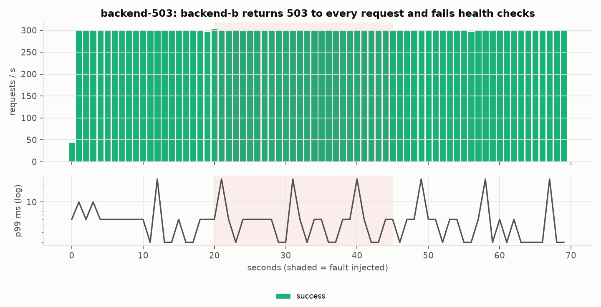
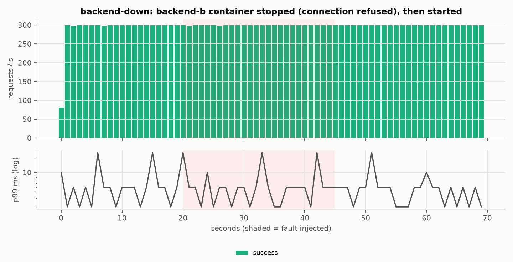
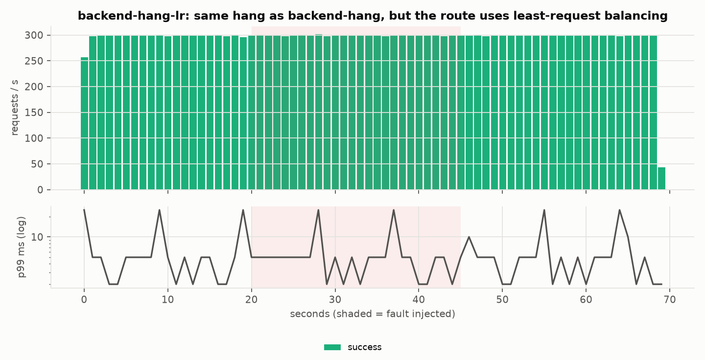
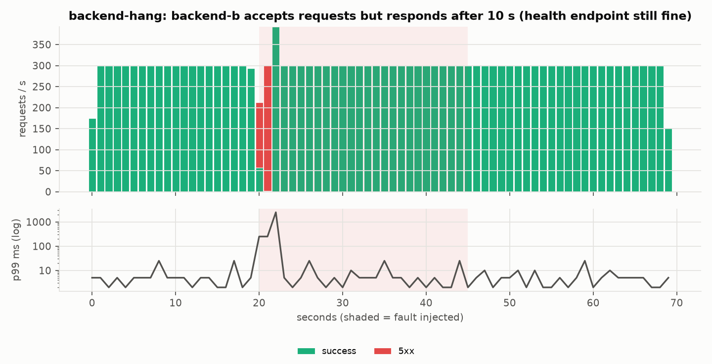
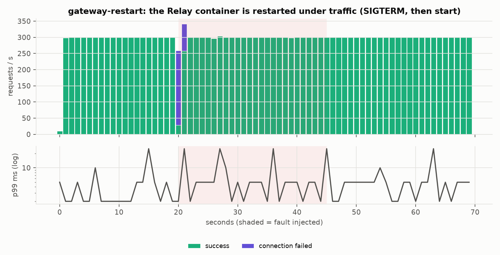
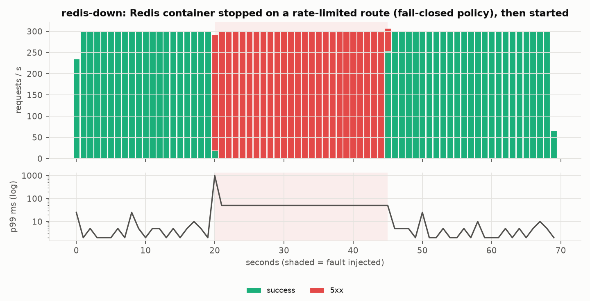
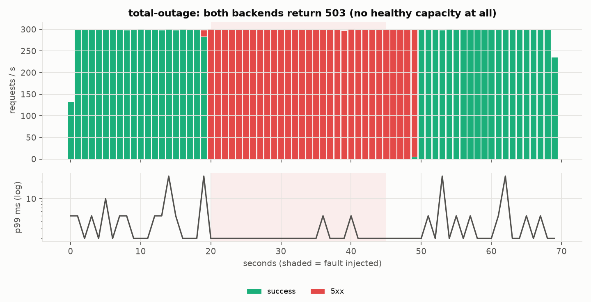

# Benchmark matrix: 20261025T060945Z-matrix

Generated by `scripts/plot_benchmarks.py` from `summary.csv` (median of repetitions, min-max range).
Raw k6 JSON for every run is in `raw/`. Local laptop numbers, not capacity claims.

## Environment

```text
timestamp_utc: 2026-10-25T06:10:07+00:00
git_commit: 1285bcc
machine: Apple M4 Pro, 12 cores
os: macOS 15.7.7
docker: 29.4.0, VM 12 CPUs 8321429504 bytes
relay python: Python 3.12.15
relay: 1 uvicorn worker (uvloop, httptools) per instance; access log on unless *-nolog
nginx: 1.27.5, worker_processes 1, upstream keepalive 64, access_log off
k6: grafana/k6:1.1.0 in the same Docker network; mock backend: 1 uvicorn worker
```

## Concurrency sweep (closed loop, 20 s per run)


| Cell | Req/s median (min-max) | p50 ms | p99 ms | Errors % | CPU % of target |
|---|---|---|---|---|---|
| concurrency-direct-vus1 | 8,460 (5,842-9,062) | 0.09 | 0.20 | 0.000 | 56 |
| concurrency-nginx-vus1 | 5,521 (3,987-6,038) | 0.14 | 0.34 | 0.000 | 25 |
| concurrency-relay-uncached-vus1 | 1,917 (1,214-1,961) | 0.47 | 0.83 | 0.000 | 85 |
| concurrency-relay-cached-vus1 | 6,161 (4,334-6,289) | 0.13 | 0.28 | 0.000 | 85 |
| concurrency-direct-vus10 | 28,124 (18,964-29,614) | 0.27 | 0.84 | 0.000 | 99 |
| concurrency-nginx-vus10 | 26,144 (17,725-27,454) | 0.30 | 0.96 | 0.000 | 57 |
| concurrency-relay-uncached-vus10 | 1,946 (1,276-2,021) | 3.90 | 30.71 | 0.000 | 100 |
| concurrency-relay-cached-vus10 | 10,122 (6,582-10,420) | 0.84 | 1.98 | 0.000 | 101 |
| concurrency-direct-vus25 | 29,288 (19,602-31,035) | 0.74 | 1.84 | 0.000 | 100 |
| concurrency-nginx-vus25 | 28,372 (18,826-28,525) | 0.74 | 1.86 | 0.000 | 56 |
| concurrency-relay-uncached-vus25 | 1,586 (1,172-1,591) | 12.17 | 59.41 | 0.000 | 100 |
| concurrency-relay-cached-vus25 | 10,366 (6,661-10,378) | 2.23 | 4.81 | 0.000 | 101 |
| concurrency-direct-vus50 | 31,246 (20,161-31,316) | 1.48 | 3.20 | 0.000 | 100 |
| concurrency-nginx-vus50 | 29,084 (19,094-29,211) | 1.55 | 3.47 | 0.000 | 56 |
| concurrency-relay-uncached-vus50 | 1,496 (1,048-1,751) | 24.64 | 135.68 | 0.000 | 100 |
| concurrency-relay-cached-vus50 | 10,154 (6,694-10,517) | 4.74 | 9.54 | 0.000 | 101 |
| concurrency-direct-vus100 | 29,494 (20,160-30,960) | 3.21 | 6.73 | 0.000 | 100 |
| concurrency-nginx-vus100 | 27,941 (19,104-28,783) | 3.21 | 7.80 | 0.000 | 55 |
| concurrency-relay-uncached-vus100 | 1,386 (998-1,481) | 69.22 | 216.07 | 0.000 | 100 |
| concurrency-relay-cached-vus100 | 9,843 (6,531-10,399) | 9.82 | 19.79 | 0.000 | 102 |

## Upstream-latency sweep (50 VUs)


| Cell | Req/s median (min-max) | p50 ms | p99 ms | Errors % | CPU % of target |
|---|---|---|---|---|---|
| latency-direct-vus50 | 30,158 (20,476-31,497) | 1.53 | 3.32 | 0.000 | 100 |
| latency-nginx-vus50 | 28,315 (19,088-29,649) | 1.59 | 3.57 | 0.000 | 56 |
| latency-relay-uncached-vus50 | 1,627 (1,115-1,734) | 26.84 | 115.66 | 0.000 | 100 |
| latency-direct-vus50-delay10 | 3,353 (3,299-3,613) | 14.79 | 18.95 | 0.000 | 26 |
| latency-nginx-vus50-delay10 | 3,330 (3,319-3,384) | 14.88 | 19.62 | 0.000 | 10 |
| latency-relay-uncached-vus50-delay10 | 987 (662-1,260) | 42.54 | 202.50 | 0.000 | 100 |
| latency-direct-vus50-delay50 | 872 (865-879) | 56.52 | 67.99 | 0.000 | 15 |
| latency-nginx-vus50-delay50 | 870 (861-891) | 56.53 | 68.92 | 0.000 | 5 |
| latency-relay-uncached-vus50-delay50 | 723 (664-726) | 67.79 | 94.47 | 0.000 | 51 |
| latency-direct-vus50-delay100 | 466 (460-470) | 106.60 | 118.26 | 0.000 | 9 |
| latency-nginx-vus50-delay100 | 466 (460-469) | 106.36 | 117.64 | 0.000 | 3 |
| latency-relay-uncached-vus50-delay100 | 410 (410-412) | 119.99 | 148.77 | 0.000 | 33 |

## Open-loop arrival-rate sweep


| Cell | Req/s median (min-max) | p50 ms | p99 ms | Errors % | Dropped iterations |
|---|---|---|---|---|---|
| openloop-nginx-rate500 | 500 (500-500) | 0.34 | 1.94 | 0.000 | 0 |
| openloop-relay-uncached-rate500 | 500 (500-500) | 0.89 | 6.12 | 0.000 | 0 |
| openloop-relay-unlimited-rate500 | 500 (500-500) | 0.87 | 6.47 | 0.000 | 0 |
| openloop-nginx-rate1000 | 1,000 (1,000-1,000) | 0.29 | 1.25 | 0.000 | 0 |
| openloop-relay-uncached-rate1000 | 1,000 (1,000-1,000) | 0.86 | 33.38 | 0.000 | 0 |
| openloop-relay-unlimited-rate1000 | 908 (881-1,000) | 0.92 | 2309.78 | 24.478 | 1824 |
| openloop-nginx-rate1500 | 1,500 (1,500-1,500) | 0.30 | 1.29 | 0.000 | 0 |
| openloop-relay-uncached-rate1500 | 1,489 (1,488-1,490) | 120.38 | 370.60 | 35.369 | 0 |
| openloop-relay-unlimited-rate1500 | 1,327 (1,308-1,339) | 0.34 | 1854.07 | 95.627 | 3448 |
| openloop-nginx-rate2000 | 2,000 (2,000-2,000) | 0.32 | 1.15 | 0.000 | 0 |
| openloop-relay-uncached-rate2000 | 1,983 (1,982-1,984) | 105.71 | 383.25 | 53.818 | 60 |
| openloop-relay-unlimited-rate2000 | 1,608 (1,600-1,608) | 0.36 | 2281.07 | 94.618 | 7848 |
| openloop-nginx-rate2500 | 2,500 (2,500-2,500) | 0.31 | 1.08 | 0.000 | 0 |
| openloop-relay-uncached-rate2500 | 2,467 (2,461-2,469) | 105.36 | 396.36 | 67.105 | 311 |
| openloop-relay-unlimited-rate2500 | 1,981 (1,582-2,025) | 0.39 | 1982.45 | 96.361 | 10372 |
| openloop-nginx-rate3000 | 3,000 (3,000-3,000) | 0.28 | 1.14 | 0.000 | 0 |
| openloop-relay-uncached-rate3000 | 2,948 (2,944-2,954) | 104.71 | 386.46 | 72.780 | 631 |
| openloop-relay-unlimited-rate3000 | 2,063 (1,870-2,469) | 0.42 | 2175.35 | 96.757 | 18743 |
| openloop-nginx-rate3500 | 3,500 (3,500-3,500) | 0.28 | 1.16 | 0.000 | 0 |
| openloop-relay-uncached-rate3500 | 3,430 (3,421-3,430) | 104.25 | 362.89 | 76.067 | 896 |
| openloop-relay-unlimited-rate3500 | 2,507 (2,132-2,758) | 0.47 | 2173.11 | 97.794 | 19848 |

## Horizontal scaling (60 VUs)


| Cell | Req/s median (min-max) | p50 ms | p99 ms | Errors % | CPU % of target |
|---|---|---|---|---|---|
| scaling-relay-pool-vus60-x1 | 1,140 (1,109-1,704) | 39.07 | 214.55 | 0.000 | 100 |
| scaling-relay-pool-vus60-x2 | 2,569 (2,210-3,657) | 17.74 | 88.51 | 0.000 | 200 |
| scaling-relay-pool-vus60-x4 | 4,893 (4,675-7,059) | 9.31 | 44.52 | 0.000 | 400 |

## Ablation: where the per-request cost goes (50 VUs)


| Cell | Req/s median (min-max) | p50 ms | p99 ms | Errors % | CPU % of target |
|---|---|---|---|---|---|
| ablation-relay-cached-vus50 | 6,681 (6,546-10,556) | 7.21 | 14.47 | 0.000 | 101 |
| ablation-relay-cached-nolog-vus50 | 9,937 (9,933-15,098) | 4.77 | 9.65 | 0.000 | 101 |
| ablation-relay-uncached-vus50 | 1,035 (1,034-1,705) | 35.47 | 195.61 | 0.000 | 100 |
| ablation-relay-uncached-nolog-vus50 | 1,208 (1,132-1,665) | 32.28 | 156.61 | 0.000 | 106 |
| ablation-relay-ratelimited-vus50 | 965 (946-1,483) | 40.17 | 190.48 | 0.000 | 100 |
| ablation-relay-cold-cache-vus50 | 1,066 (1,029-1,504) | 36.27 | 173.01 | 0.000 | 100 |

## Cache stampede: 100 VUs on one hot key that rotates every 200 ms, 50 ms upstream


| Cell | Req/s median (min-max) | p50 ms | p99 ms | Upstream requests per client request |
|---|---|---|---|---|
| stampede-relay-coalesce-vus100-delay50 | 4,742 (4,736-7,023) | 14.90 | 74.94 | 0.0011 |
| stampede-relay-nocoalesce-vus100-delay50 | 3,595 (3,559-5,853) | 14.84 | 144.81 | 0.0896 |

## Brownout: backend-b fails every 2nd request with 503 (20 VUs)


| Cell | Req/s median (min-max) | p50 ms | Errors % | Upstream requests per client request |
|---|---|---|---|---|
| brownout-relay-budget-vus20 | 1,005 (1,001-1,018) | 11.20 | 4.283 | 1.2072 |
| brownout-relay-nobudget-vus20 | 1,005 (998-1,024) | 10.51 | 0.000 | 1.2502 |
| brownout-relay-budget-single-vus20 | 1,026 (965-1,054) | 10.18 | 39.646 | 1.2071 |
| brownout-relay-nobudget-single-vus20 | 663 (662-667) | 10.15 | 11.305 | 1.7739 |

## Chaos timelines (300 req/s open loop; fault from t=20 s to t=45 s)

| Scenario | Reps | Fault-window errors % (per rep) | Max p99 in fault window ms (per rep) | Errors after recovery (per rep) |
|---|---|---|---|---|
| backend-down | 3 | 0.0, 0.0, 0.0 | 25.0, 25.0, 25.0 | 0, 0, 0 |
| backend-hang | 3 | 6.049, 6.008, 6.021 | 2500.0, 2500.0, 2500.0 | 0, 0, 0 |
| backend-hang-lr | 3 | 0.0, 0.0, 0.0 | 25.0, 25.0, 25.0 | 0, 0, 0 |
| backend-503 | 3 | 0.0, 0.0, 0.0 | 25.0, 10.0, 25.0 | 0, 0, 0 |
| total-outage | 3 | 100.0, 100.0, 100.0 | 5.0, 5.0, 50.0 | 1495, 1494, 1498 |
| redis-down | 3 | 99.746, 99.733, 99.439 | 1000.0, 1000.0, 1000.0 | 54, 47, 46 |
| gateway-restart | 3 | 4.173, 4.187, 4.08 | 25.0, 50.0, 50.0 | 0, 0, 0 |















