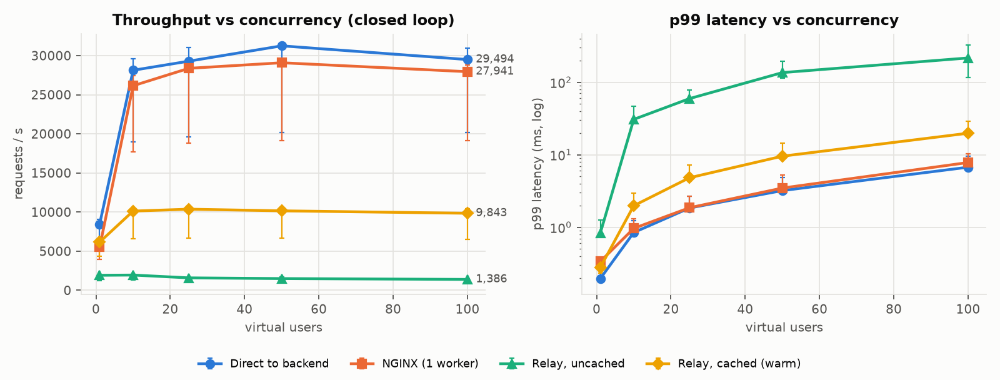
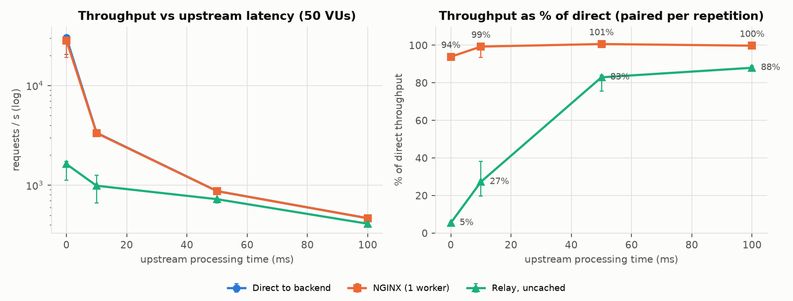
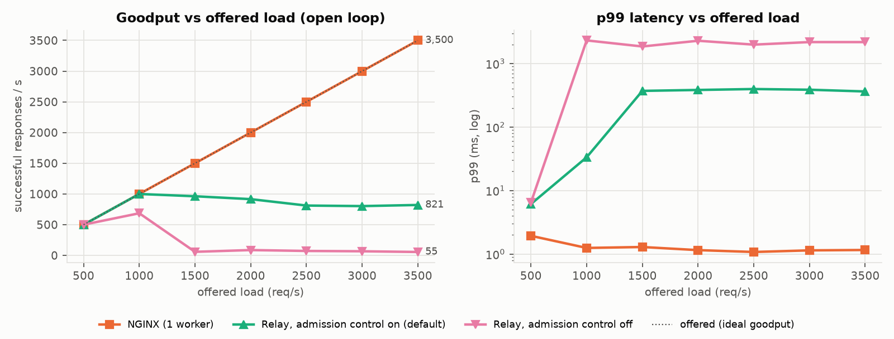
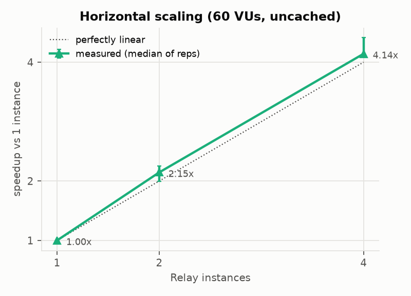
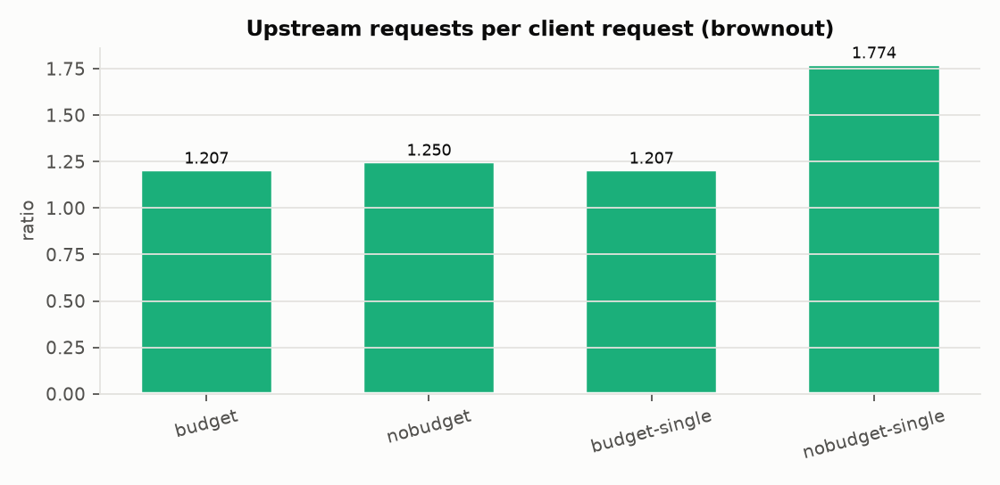
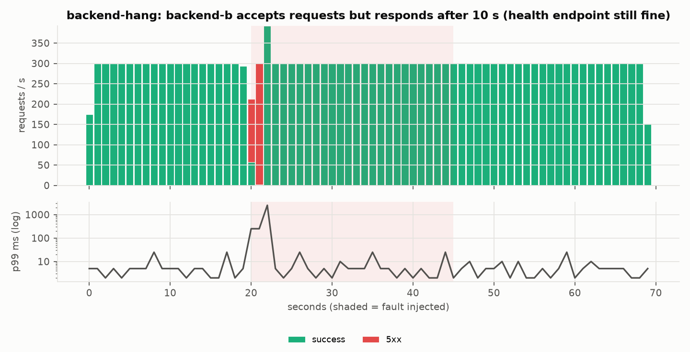
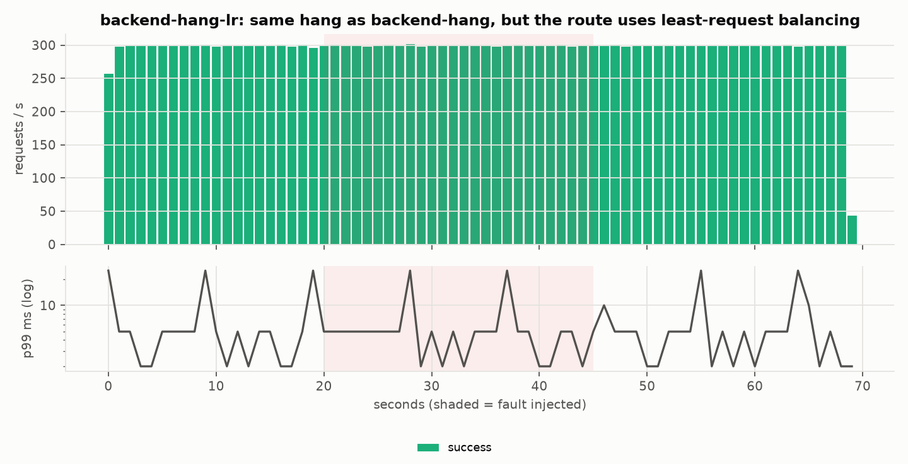
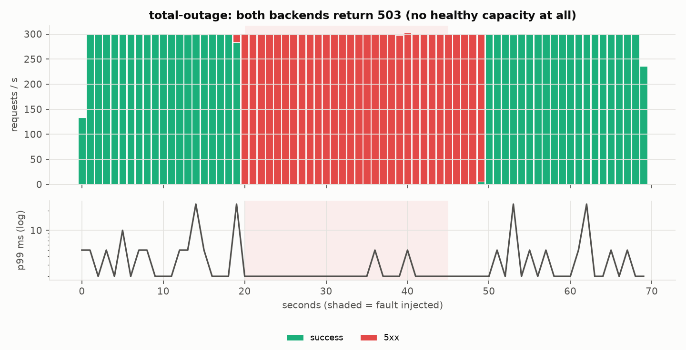

# Benchmark Report: Relay v1

Every number here comes from files in `benchmarks/results/`, generated by
`scripts/bench_matrix.py`, `scripts/chaos_timeline.py`, and
`scripts/plot_benchmarks.py`. Nothing was typed by hand. These are
**single-laptop measurements, not capacity claims**.

* Main matrix: [`20261025T060945Z-matrix/`](../benchmarks/results/20261025T060945Z-matrix/SUMMARY.md)
  (198 runs; open-loop cells from an isolated re-run, see `MERGE_NOTE.md`)
* Chaos timelines: see [Failure behavior](#failure-behavior-chaos-timelines)
* Earlier v0.1 report: [`20261025T025934Z/`](../benchmarks/results/20261025T025934Z/SUMMARY.md)

## Environment and method

* Apple M4 Pro (12 cores), macOS 15.7; Docker 29.4 VM (12 CPUs, ~7.75 GiB).
* Relay image: Python 3.12, FastAPI/Starlette, Uvicorn (uvloop, httptools),
  httpx 0.28.1. **One Uvicorn worker (one core) per Relay instance.**
* NGINX 1.27.5 with `worker_processes 1` (one core, like Relay), upstream
  keep-alive, access log off. It is the reference for "what a mature proxy
  costs".
* k6 1.1.0, the mock backend (1 worker), Redis, and every proxy run in the
  same Docker network.
* 20 s per run, **3 repetitions per cell, interleaved** (rep 1 of every
  cell, then rep 2, ...). Backend counters reset before each run, so
  "upstream requests per client request" is exact.
* **Run validity guards:** a run whose wall time exceeds 1.5× its planned
  duration is discarded and repeated. This caught host sleep freezing the
  Docker VM, which had produced 106-second "requests". Breakers must be
  closed before a run starts. Every open-loop cell starts from a freshly
  restarted gateway.

### A note on drift: why this report leans on paired ratios

Partway through repetition 2, **the whole environment slowed by about 35%**:
the direct-to-backend path and NGINX as much as Relay. No thermal warning was
recorded; it is most likely macOS power management. Separately, the *same
v0.1 Relay image* measured 1,402 req/s in an earlier session and 2,035 req/s
in this one (A/B in `benchmarks/results/ab/`). **Absolute numbers on a
laptop are not stable across time.** Ratios between paths measured *within
the same repetition* are: for example, Relay ÷ direct at 50 VUs was 0.052
(range 0.048–0.056) across the three repetitions. So this report states
comparisons as **paired ratios** (median and range across repetitions), and
quotes absolute numbers only alongside them.

## 1. Overhead of the gateway hop

Throughput relative to going direct, paired per repetition (median [min–max]):

| VUs | NGINX ÷ direct | Relay cached ÷ direct | Relay uncached ÷ direct | Relay cached ÷ uncached |
|---|---|---|---|---|
| 1 | 0.67 [0.65–0.68] | 0.73 [0.69–0.74] | 0.22 [0.21–0.23] | 3.2× |
| 10 | 0.93 [0.93–0.94] | 0.35 [0.35–0.36] | 0.068 [0.067–0.069] | 5.2× |
| 50 | 0.93 [0.93–0.95] | 0.33 [0.33–0.34] | 0.052 [0.048–0.056] | 6.4× |
| 100 | 0.95 [0.93–0.95] | 0.33 [0.32–0.34] | 0.049 [0.045–0.050] | 6.6× |

**Interpretation.**

* Against a backend that does *no* work, an uncached request through Relay
  costs about 15–20× a direct request. Relay is pinned at 100% of its single
  core in every saturated cell (container CPU), so the throughput ceiling is
  Relay's per-request CPU cost: the Python ASGI stack, the pipeline, metrics,
  the access log, and an httpx/httpcore upstream call.
* NGINX with one worker reaches 93–95% of direct. **The gap to NGINX is the
  cost of a Python proxy hop, and it is large.** Relay's value is its
  policies (rate limiting, caching, breakers, admission control), not raw
  proxy speed.
* Uncached throughput *falls* as concurrency rises (0.068 → 0.049 of direct).
  Profiling earlier showed httpcore scanning every pooled connection on each
  request, so per-request cost grows with the number of connections. That
  also explains the scaling result below.
* Caching delivers 5–7× the uncached throughput for repeated GETs.

### Why the cached path reaches only ~33% of direct (audit A7): ablation at 50 VUs

| Variant (paired with the same rep) | Throughput ratio | What it isolates |
|---|---|---|
| cached, access log **off** ÷ cached, log on | **1.49** [1.43–1.52] | The JSON access log costs about a third of the cached path's CPU |
| uncached, log off ÷ uncached, log on | 1.09 [0.98–1.17] | Smaller share when an upstream call dominates |
| rate-limited ÷ uncached | 0.92 [0.87–0.93] | One Redis Lua round trip per request ≈ 8% |
| cold cache (miss + store) ÷ uncached | 1.00 [0.88–1.03] | A cache miss costs no more than no cache |
| cached ÷ uncached | 6.3 [6.2–6.5] | Value of a hit |

So a cached hit is cheap, *but* every request still pays for the Python
ASGI/Starlette stack, the middleware, and one structured log line. The access
log alone is the biggest single item on the hot cached path. A production
deployment would sample or buffer access logs.

## 2. Upstream latency: overhead in context

Relay throughput as % of direct, paired per repetition, at 50 VUs:

| Upstream processing time | 0 ms | 10 ms | 50 ms | 100 ms |
|---|---|---|---|---|
| NGINX | 94% | 99% | 101% | 100% |
| **Relay, uncached** | **5%** | **27%** | **83%** | **88%** |

The overhead is a fixed CPU cost per request. With a backend doing realistic
work (tens of milliseconds), Relay delivers **83–88% of direct throughput**,
and at 100 ms it adds about 13 ms to p50 (106.6 → 120.0 ms).

## 3. Overload: open-loop arrival-rate sweep (audit A5, A17)

Closed-loop tests (fixed users, no think time) hide queueing: when the server
slows down, the clients slow down with it ("coordinated omission"). Open-loop
tests send a fixed arrival rate regardless, which is how real traffic behaves.
**Goodput** = successful responses per second; shed 503s don't count. Medians
of 3 isolated runs (each cell starts from a freshly restarted gateway):

| Offered req/s | NGINX goodput | **Relay (admission control on, default)** | Relay (admission control **off**) |
|---|---|---|---|
| 500 | 500 | 500 (p99 6 ms) | 500 (p99 6 ms) |
| 1,000 | 1,000 | 1,000 (p99 33 ms) | 666 (p99 2.3 s) |
| 1,500 | 1,500 | **962** (35% shed, p99 371 ms) | **58** (96% errors, p99 1.9 s) |
| 2,500 | 2,500 | **809** (67% shed, p99 396 ms) | **72** (96% errors, p99 2.0 s) |
| 3,500 | 3,500 | **821** (76% shed, p99 363 ms) | **61** (98% errors, p99 2.2 s) |

* **Without admission control, overload is a metastable collapse.** Requests
  queue inside Relay until they hit the 2 s attempt timeout, the circuit
  breaker blames the *healthy* backend and opens, and goodput falls to about
  60 req/s. This failure was found by the v0.1 version of this experiment
  (audit A17), along with the connection-pool leak that made it permanent
  (A16).
* **With admission control** (64 in flight, a 100 ms FIFO wait queue, then a
  cheap 503 + `Retry-After`), Relay keeps serving at roughly its capacity,
  about 0.8–1.0k req/s here (**11–17× the goodput of the uncontrolled
  variant** at 1,500–3,500 req/s offered), with bounded p99 (~0.4 s) and no breaker trips.
* Goodput sags somewhat as offered load rises (962 → 821): every rejected
  request still costs HTTP parsing in Uvicorn. Rejecting in a C-level proxy
  in front of Relay would avoid that cost.
* NGINX is not overloaded at any rate tested.

## 4. Horizontal scaling

Speedup vs one instance, paired per repetition, at 60 VUs total: **2.15×
with 2 instances, 4.14× with 4.** Slightly super-linear because each
instance then serves fewer concurrent requests (60 → 15), which is cheaper
per request (section 1). It is not free capacity. Redis-backed rate limits
stay global across instances (tested separately, 3 OS processes).

## 5. Cache stampede: request coalescing (audit A3)

100 VUs all request the same key, which rotates every 200 ms (so every
rotation is a cold miss for 100 concurrent clients), and the backend takes
50 ms:

| | Upstream requests per client request | p99 |
|---|---|---|
| Coalescing **off** | 0.090 (reps: 0.055, 0.090, 0.090) | 145 ms |
| Coalescing **on** (default) | **0.0011** (0.0007, 0.0011, 0.0011) | **75 ms** |

**About 80× fewer requests reach the backend** during stampedes, and p99
halves, because followers wait for one in-flight fetch instead of each
paying the 50 ms.

## 6. Brownout: retry budget (audit A4)

A backend fails every second request with 503 but stays "healthy" (health
endpoint fine; breaker threshold set high so only the budget acts). 20 VUs,
`max_attempts: 3`, 3 reps (values identical to ±0.01 across reps):

| Scenario | Retry budget | Load on the failing backend (upstream requests ÷ client requests) | Client errors |
|---|---|---|---|
| Two backends; retries can go to the healthy one | off | 1.25× | 0% |
| | **on (20%)** | **1.21×** | 4.3% |
| One backend; retries hit the **same** struggling service | off | **1.77×** (theory: 1 + ½ + ¼ = 1.75) | 11.3% |
| | **on (20%)** | **1.21×** | 39.6% |

The budget does exactly what it promises: retries add at most about 20% of
extra load, so in the single-backend case the struggling service sees **32%
less load** (1.77× → 1.21×). **The cost is availability:** requests a retry
would have rescued fail instead (11% → 40% errors here). That's the right
trade when failures grow with load, as in a real brownout, because shedding
retry load lets the service recover. This mock fails at a fixed rate
regardless of load, so it shows the cost but cannot show the recovery
benefit. With a healthy alternative backend, retries are cheap and
useful, and the budget barely matters (1.25× → 1.21×).

## Failure behavior: chaos timelines

`scripts/chaos_timeline.py`, results in
[`20261025T172829Z-chaos/`](../benchmarks/results/20261025T172829Z-chaos/). k6
sends a fixed 300 req/s (open loop) through Relay for 70 s. At t=20 s a fault
is injected, and at t=45 s it is undone. The client-side timeline (status codes
and latency per second) is merged with the gateway's own view (breaker and
health state polled every second, counters diffed). Two backends behind
`/api/bench-ha` unless noted. **3 repetitions each, all valid** (every k6
run took exactly 70 s, VM clock offset measured and corrected per run).

| Scenario | Client errors during the 25 s fault (3 reps) | Worst p99 | Errors after recovery | What happened (gateway counters, rep 1) |
|---|---|---|---|---|
| Backend killed (container stopped) | **0%, 0%, 0%** | 25 ms | 0 | 5 connect errors retried on backend-a; breaker opened and rejected 884 attempts; half-open probe closed it after recovery |
| Backend returns 503 + fails health | **0%, 0%, 0%** | ≤25 ms | 0 | 5 failed attempts retried; breaker + health checks took it out |
| Backend **hangs** (10 s), round-robin | 6.0%, 6.0%, 6.0% | 2.5 s | 0 | Requests hung on b held the admission slots ~2 s, so healthy-backend traffic was shed (audit A19) until b's breaker opened |
| Backend hangs, **least-request** | **0%, 0%, 0%** | **25 ms** | 0 | Only 7 attempts timed out on b before it was avoided |
| **Total outage** (both backends 503) | 100% (nothing can succeed) | ≤50 ms | ~1,495 (~5 s) | Breakers failed fast: **only 14 of ~7,500 requests reached the failing backends**. Recovery waits for the next half-open probe (`recovery_timeout_seconds: 10`) |
| Redis stopped (rate-limited route) | 99.7%, 99.7%, 99.4% (by design) | 1.0 s | ~50 (~0.17 s) | Fail-closed 503 `rate_limiter_unavailable`; automatic recovery when Redis returned |
| Gateway restarted (single instance) | 4.2%, 4.2%, 4.1% | ≤50 ms | 0 | About 1 s of connection failures while the process restarted |

Charts (rep 1 of each):

**Reading these honestly.** "0% errors" holds for *these* faults with a
healthy second backend; it is not a general claim. Total outages and Redis
loss produce errors by design. The post-outage tail (~5 s) and the restart
gap (~1 s, single instance) are tunable trade-offs: a shorter breaker
recovery timeout recovers faster but probes a dead service more often, and
two instances behind a load balancer would hide a restart.

## Limitations

* One laptop; every component shares one Docker VM. Absolute numbers drift
  over time (see above); trust the paired comparisons.
* One Uvicorn worker per instance; the mock backend does almost no work, which
  is the worst case for relative overhead.
* Runs are 20 s (no soak test); the open-loop sweep tests up to 3,500 req/s.
* NGINX was configured as a plain proxy; it does none of Relay's
  per-request policy work, so it is a floor, not a like-for-like competitor.
